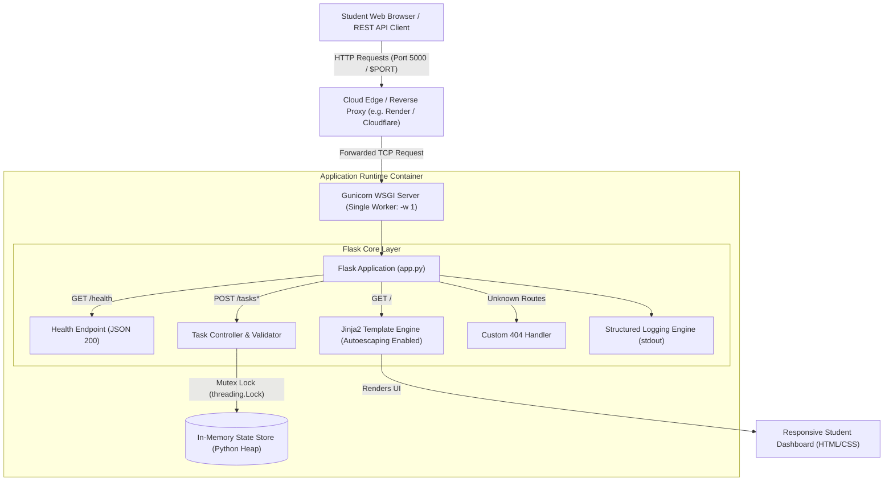

# Cloud-Based Student Task Manager
**Cloud Computing Laboratory Assignment 8 Mini Project**

A cloud-native web application built with Python Flask, responsive HTML/CSS, thread-safe in-memory state persistence, Gunicorn WSGI production server, and an automated test suite.

---

## 1. System Architecture

The following diagram illustrates the deployment topology, request flow, and runtime components:



---

## 2. Architectural Analysis: Single-Worker Rationale & In-Memory Constraints

### 2.1 Why Exactly One Gunicorn Worker (`-w 1`) is Required
In production Python deployments, WSGI servers like Gunicorn typically fork multiple worker operating system processes (e.g., `2 * cores + 1`) to handle concurrent traffic. However, in this project:
- **Process Memory Isolation:** Each worker process spawned by Gunicorn runs in its own distinct virtual memory address space.
- **State Divergence & Desynchronization:** If multiple workers were configured (e.g., `-w 4`), successive requests from the same student browser would be routed round-robin across worker processes. A task added in Worker A would not exist in the memory space of Worker B, C, or D, resulting in intermittent "ghost tasks", missing data, and unpredictable status toggles.
- **Inter-Process Synchronization Overhead:** Because the application does not use an external cache (Redis) or database (PostgreSQL), memory cannot be shared across OS processes without complex Inter-Process Communication (IPC).
- **Conclusion:** A single worker (`gunicorn -w 1 -b 0.0.0.0:$PORT app:app`) is strictly mandatory when using in-memory state.

### 2.2 Limitations of In-Memory Storage in Cloud Environments
While in-memory storage provides zero-dependency simplicity for laboratory prototypes, it presents critical limitations in production cloud architectures:
1. **Ephemeral Lifecycle:** Server restarts, rolling container updates, crash recoveries, and host migrations instantly wipe all stored tasks.
2. **Scale-to-Zero Dyno Sleeping:** Free-tier cloud providers (Render, Railway, Heroku) spin down idle containers. When awakened by a new incoming request, the memory heap re-initializes from scratch, wiping all user data.
3. **Horizontal Scaling Incompatibility:** The service cannot horizontally autoscale across multiple instances or pods behind a cloud load balancer without immediate state fragmentation.
4. **Memory Leaks and Exhaustion:** As task volume grows, memory consumption increases linearly on the host container. Without eviction policies (LRU/TTL), this risks Out-Of-Memory (OOM) process termination.
5. **Production Migration Path:** In enterprise production, in-memory state should be replaced with a managed cloud relational database (e.g., PostgreSQL / Amazon RDS) or a cloud distributed cache (e.g., Redis / AWS ElastiCache).

---

## 3. Technology Stack

- **Backend:** Python 3.12, Flask 3.1.2
- **Frontend:** Semantic HTML5, CSS3 with Custom Properties (variables), Minimal Vanilla JavaScript (for live character counting)
- **WSGI Production Server:** Gunicorn 23.0.0
- **Testing Framework:** Python standard library `unittest`
- **Development Environment:** Windows 11 PowerShell

---

## 4. Local Development Setup (Windows 11 PowerShell)

Follow these step-by-step instructions to run the application locally on Windows 11 using PowerShell:

### Step 1: Open PowerShell and Navigate to the Project Directory
```powershell
Set-Location -Path "C:\Users\shlok\.gemini\antigravity\scratch\cloud-student-task-manager"
```

### Step 2: (Optional) Set Execution Policy for Virtual Environment Activation
```powershell
Set-ExecutionPolicy -Scope Process -ExecutionPolicy Bypass
```

### Step 3: Create and Activate Virtual Environment
```powershell
python -m venv venv
.\venv\Scripts\Activate.ps1
```

### Step 4: Install Dependencies
```powershell
pip install -r requirements.txt
```

### Step 5: Run the Application Locally
```powershell
python app.py
```
*The server will start on `http://127.0.0.1:5000/`.*

### Step 6: Test the Endpoints Locally
- Open browser and navigate to: `http://localhost:5000/`
- Check API health endpoint: `http://localhost:5000/health`
- Or use PowerShell `Invoke-RestMethod`:
```powershell
Invoke-RestMethod -Uri "http://localhost:5000/health" -Method Get
```

---

## 5. Automated Test Suite & Results

The test suite is built on Python's native `unittest` framework and uses the Flask test client to validate all business rules, endpoints, and security protections.

### Command to Execute Test Suite:
```powershell
python -m unittest discover -s tests -p "test_*.py" -v
```

### Test Case Verification Matrix

| Test ID | Test Method | Target Endpoint | Input Condition / Scenario | Expected Outcome | Status |
|---|---|---|---|---|---|
| TC-01 | `test_01_homepage_renders_successfully` | `GET /` | Initial request | HTTP 200, renders task dashboard UI | **PASS** |
| TC-02 | `test_02_health_endpoint` | `GET /health` | Health probe ping | HTTP 200, JSON `status: healthy`, counter matches | **PASS** |
| TC-03 | `test_03_task_creation_valid` | `POST /tasks` | Valid title (1-120 chars) via Form & JSON | HTTP 200 (redirect) / HTTP 201 (JSON), task persisted | **PASS** |
| TC-04 | `test_04_task_creation_empty_rejected` | `POST /tasks` | Empty string `""` or whitespace `"     "` | HTTP 400, validation message returned | **PASS** |
| TC-05 | `test_05_task_creation_exceeds_120_chars_rejected` | `POST /tasks` | 121-character string vs 120-character string | HTTP 400 for 121 chars; HTTP 201 for 120 chars | **PASS** |
| TC-06 | `test_06_toggle_task_completion_and_undo` | `POST /tasks/<id>/toggle` | Valid task ID | HTTP 200, toggles `completed` flag True/False | **PASS** |
| TC-07 | `test_07_task_deletion` | `POST /tasks/<id>/delete` | Valid task ID | HTTP 200, task removed from memory | **PASS** |
| TC-08 | `test_08_nonexistent_task_operations_return_404` | `POST /tasks/999/*` | Non-existent task ID | HTTP 404 Not Found | **PASS** |
| TC-09 | `test_09_unknown_url_returns_404` | `GET /unmapped-path` | Unregistered endpoint | HTTP 404, renders custom 404 error page / JSON | **PASS** |
| TC-10 | `test_10_safe_jinja_rendering_xss_protection` | `POST /tasks` | `<script>alert('xss')</script>` payload | HTML auto-escaped as `&lt;script&gt;` | **PASS** |

**Execution Summary:** `Ran 10 tests in 0.088s - OK`

---

## 6. Cloud Hosting & Deployment Guide (Free-Tier Provider)

> [!CAUTION]
> **SAFETY & LAB POLICY NOTICE:**
> In accordance with safety restrictions, **no cloud resources have been provisioned or paid services activated**.
> The following instructions document how to deploy to Render's free tier. **Wait for laboratory instructor approval before provisioning any cloud service.**

### Deployment Target: Render (Free Web Service)
1. **Initialize Git Repository:**
   ```powershell
   git init
   git add .
   git commit -m "Initial commit of Student Task Manager"
   ```
2. **Push to GitHub:**
   - Create a private or public repository on GitHub.
   - Run `git remote add origin <your-repo-url>` and `git push -u origin main`.
3. **Configure Render Web Service:**
   - Log into the Render dashboard (`https://dashboard.render.com`).
   - Click **New +** -> **Web Service**.
   - Connect your GitHub repository.
   - Settings:
     - **Name:** `student-task-manager-lab8`
     - **Region:** Closest geographic region (e.g., Singapore, Frankfurt, Oregon)
     - **Branch:** `main`
     - **Runtime:** `Python 3`
     - **Build Command:** `pip install -r requirements.txt`
     - **Start Command:** `gunicorn -w 1 -b 0.0.0.0:$PORT app:app`
     - **Instance Type:** `Free` (0.1 CPU, 512 MB RAM)
4. **Environment Variables:**
   - Add `SECRET_KEY`: Set to a cryptographically secure random string.
   - Add `FLASK_DEBUG`: Set to `0`.
5. **Health Check Path:**
   - Set health check path to `/health` in Render Advanced Settings.

---

## 7. Cloud Resource Inventory Template

Use this inventory template when submitting Assignment 8:

| Resource Item | Description | Provider / Service | Config / Size | Cost Tier |
|---|---|---|---|---|
| Compute | Web Application Host | Render / Railway / Local | 0.1 vCPU, 512 MB RAM | Free Tier ($0.00) |
| Web Server | WSGI Application Server | Gunicorn 23.0 | 1 Worker Process (`-w 1`) | Bundled / Open Source |
| Runtime | Application Framework | Python 3.12 / Flask 3.1 | Python Virtual Environment | Open Source |
| Storage | State Storage Engine | Python Process Heap | Thread-Safe Mutex Lock | In-Memory ($0.00) |
| Network | Inbound Port Routing | Dynamic Cloud `$PORT` | 0.0.0.0 Binding | Free Tier ($0.00) |

---

## 8. Monitoring and Logging Checklist

- [x] **Standard Output Logging:** Application logs all lifecycle events (`INFO`, `WARNING`, `ERROR`) to `sys.stdout` for cloud container log ingestion.
- [x] **Credential Redaction:** Application strictly avoids logging session tokens, credentials, or raw user authentication data.
- [x] **Automated Health Probe:** `GET /health` endpoint available for external uptime monitoring and container liveness probes.
- [x] **HTTP Status Code Integrity:** Correct use of 200, 201, 400, 404, and 500 status codes.
- [x] **Structured Event Tracking:** Creation, toggling, deletion, and validation failures logged with timestamps and task identifiers.
- [x] **Error Boundaries:** 404 and 500 exceptions caught gracefully without exposing server stack traces to users.

---

## 9. Security Checklist

- [x] **Jinja2 Auto-Escaping:** User inputs are rendered using standard Jinja syntax `{{ task.title }}` without bypassing escaping via the `| safe` filter, preventing Cross-Site Scripting (XSS).
- [x] **Strict Input Validation:** Form and API controllers enforce non-empty rules and a hard limit of 120 characters to prevent buffer issues or UI distortion.
- [x] **Debug Mode Protection:** `debug` is disabled outside local development via `FLASK_DEBUG` environment variable checking.
- [x] **Thread Concurrency Safety:** Shared in-memory list operations are guarded by `threading.Lock()` to prevent race conditions during concurrent requests.
- [x] **Zero Secrets in Repository:** `.gitignore` excludes `.env`, secrets, virtual environments, and temporary files.

---

## 10. Assignment 8 Academic Report Outline

Students can structure their final laboratory report using this outline:

1. **Title Page & Student Information**
   - Course: Cloud Computing Laboratory
   - Assignment: Lab 8 Mini Project - Cloud-Based Student Task Manager
   - Student Name, Roll Number, Date
2. **Abstract & Project Objectives**
   - Overview of cloud application architecture, WSGI model, and state persistence patterns.
3. **System Design & Architecture**
   - High-level architecture diagram (Mermaid).
   - Component interaction (Client -> WSGI Server -> Flask Engine -> In-Memory Store).
4. **Technical Implementation Details**
   - In-memory data management and concurrency control using Mutex Lock.
   - Endpoint definitions: `/`, `/tasks`, `/tasks/<id>/toggle`, `/tasks/<id>/delete`, `/health`.
   - Responsive user interface and accessibility features.
5. **Architectural Trade-offs & Cloud Constraints**
   - Technical justification for the single-worker Gunicorn constraint (`-w 1`).
   - Comprehensive analysis of in-memory storage limitations (ephemerality, dyno sleep, horizontal scaling).
6. **Testing and Verification**
   - Test methodology using Python's `unittest` framework.
   - Test execution results table (10 test cases, 100% pass rate).
7. **Cloud Deployment Plan & Operational Checklists**
   - Free-tier cloud hosting strategy (Render / Railway).
   - Monitoring, logging, and security verification checklists.
8. **Conclusion & Future Enhancements**
   - Summary of outcomes.
   - Proposed migration path to persistent managed databases (PostgreSQL/Redis) and multi-worker autoscaling.
